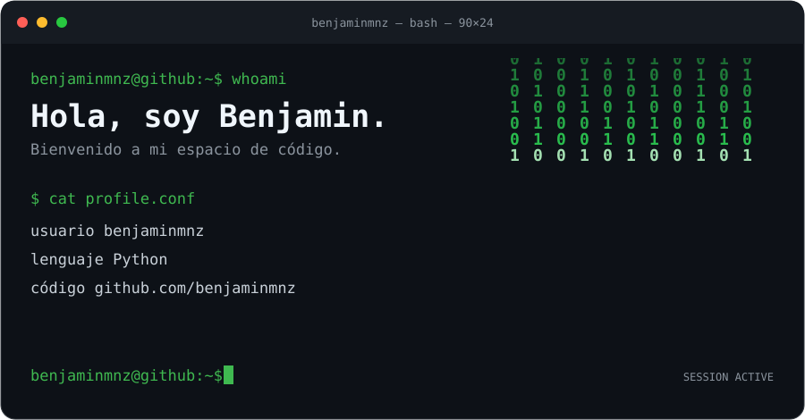

### `$ ls ~/certifications`

**Introduction to Cybersecurity** · Cisco  
Insignia de finalización del curso · 16 de noviembre de 2026  
[Verificar insignia en Credly →](https://www.credly.com/badges/91b0f564-b755-46ef-8a6c-3645ecc6ff15/public_url)

### `$ ls ~/projects`

| Proyecto | Código |
| :--- | :--- |
| **EcoTech** · Proyecto en Python | [Abrir repositorio →](https://github.com/benjaminmnz/EcoTech) |

### `$ git remote -v`

[GitHub · @benjaminmnz](https://github.com/benjaminmnz)
